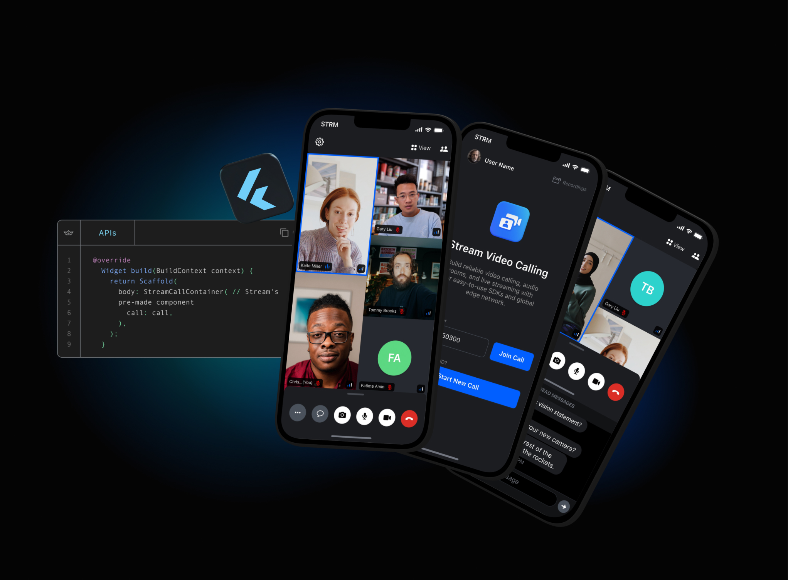
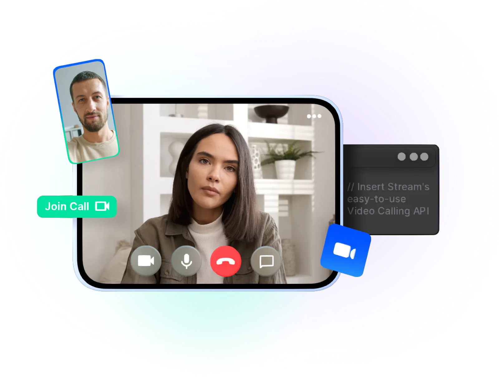
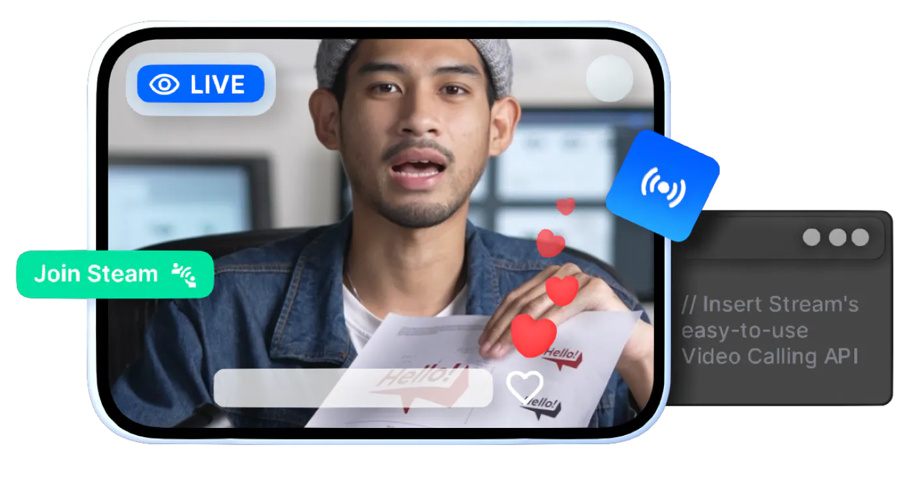

# Flutter tutorials for the [Stream Video SDK](https://getstream.io/video/sdk/flutter/)



The Flutter SDK for Video & Audio provides pre-built widgets so developers can move quickly to integrate real-time video capabilities in their applications. 
Using our SDK, developers can opt to use our customizable out-of-the-box solution or write their own UIs using our low-level SDK – all while avoiding the hard parts of multi-platform development.

- [Register](https://getstream.io/video/) to get an API key for Stream Video

This repository contains the example projects for the [tutorials](https://getstream.io/video/sdk/flutter/) for the Stream Video Flutter SDK.

## Running the Tutorials

The tutorial projects don't contain any Stream credentials. Each one reads your API key and user tokens from `env/env.json`, which git ignores. Create one for every tutorial with the generator script. It asks for your API key and secret from the [Stream Dashboard](https://dashboard.getstream.io/) and signs the user tokens locally. The secret is not stored:

```bash
scripts/generate_env.sh
```

To configure only some tutorials, pass their directories, for example `scripts/generate_env.sh video_calling_tutorial`. You can also copy a tutorial's `env/env.example.json` to `env/env.json` and fill it in yourself.

Then run the tutorial as usual with `flutter run` or from your IDE. See the README of each tutorial for the values it needs. The ringing tutorial also needs your own Firebase project.

## Flutter Video Calling Tutorial



📚 [Video Calling Tutorial](https://getstream.io/video/sdk/flutter/tutorial/video-calling/)   |||   💻 [Video Calling Repository](https://github.com/GetStream/flutter-video-tutorials/tree/main/video_calling_tutorial)

The Flutter Video Calling tutorial shows you how to quickly build a Video Calling app leveraging Stream's Video API and the Stream Video Flutter components. 
The underlying API is very flexible and allows you to build nearly any type of video experience.

## Flutter Livestreaming Tutorial



📚 [Livestreaming Tutorial](https://getstream.io/video/sdk/flutter/tutorial/livestreaming/)   |||   💻 [Livestreaming Repository](https://github.com/GetStream/flutter-video-tutorials/tree/main/livestreaming_tutorial)

The Flutter livestreaming tutorial shows you how to quickly build a Livestreaming app leveraging Stream's Video API and the Stream Video Flutter components. 
The underlying API is very flexible and allows you to build nearly any type of video experience.

## Flutter Audio Rooms Tutorial


📚 [Audio Rooms Tutorial](https://getstream.io/video/sdk/flutter/tutorial/audio-room/)   |||   💻 [Audio Rooms Repository](https://github.com/GetStream/flutter-video-tutorials/tree/main/audioroom_tutorial)

The Flutter audio room tutorial shows you how to quickly build an Audio Room app leveraging Stream's Video API and the Stream Video Flutter components. 
The underlying API is very flexible and allows you to build nearly any type of video experience.

## Flutter Ringing Tutorial


📚 [Ringing Tutorial](https://getstream.io/video/sdk/flutter/tutorial/ringing/)   |||   💻 [Ringing Repository](https://github.com/GetStream/flutter-video-tutorials/tree/main/ringing_tutorial)

The Flutter Ringing tutorial provides a step-by-step guide to building an app with ringing functionality using Stream's Video API and Stream Video Flutter components.