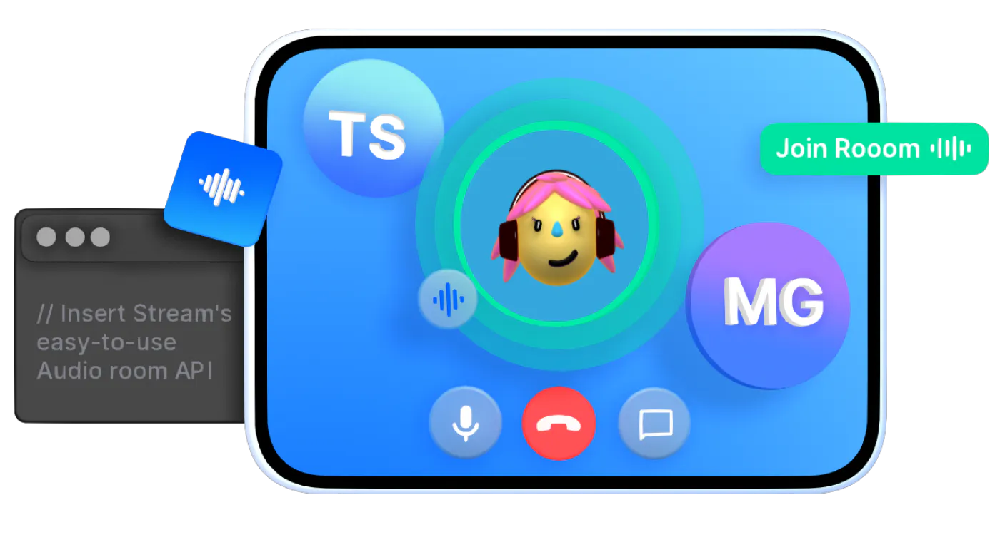

## Flutter Audio Rooms Tutorial



📚 [Audio Rooms Tutorial](https://getstream.io/video/sdk/flutter/tutorial/audio-room/)   |||   💻 [Audio Rooms Repository](https://github.com/GetStream/flutter-video-tutorials/tree/main/audioroom_tutorial)

The Flutter audio room tutorial shows you how to quickly build an Audio Room app leveraging Stream's Video API and the Stream Video Flutter components.
The underlying API is very flexible and allows you to build nearly any type of video experience.

## Running the Tutorial

The project doesn't contain any Stream credentials. It reads the API key and the user tokens from `env/env.json` when it starts:

| Key | Value |
| --- | --- |
| `STREAM_API_KEY` | Your Stream API key from the [Stream Dashboard](https://dashboard.getstream.io/) |
| `STREAM_TOKEN_ALICE_JOHNSON_AUDIOROOM` | A user token for `alice_johnson_audioroom` |
| `STREAM_TOKEN_BOB_SMITH_AUDIOROOM` | A user token for `bob_smith_audioroom` |
| `STREAM_TOKEN_CHARLIE_BROWN_AUDIOROOM` | A user token for `charlie_brown_audioroom` |

The quickest way to create it is the generator script in the repository root. It asks for your API key and secret from the [Stream Dashboard](https://dashboard.getstream.io/) and signs the tokens locally. The secret is not stored:

```bash
scripts/generate_env.sh audioroom_tutorial
```

Alternatively, copy `env/env.example.json` to `env/env.json` and fill in the values yourself. You can generate user tokens with the [token generator](https://getstream.io/chat/docs/flutter-dart/tokens_and_authentication/#manually-generating-tokens).

Then run the app as usual with `flutter run` or from your IDE. If `env/env.json` is missing values, the app shows a setup screen listing them. `env/env.json` is ignored by git, so your credentials stay out of the repository.

> [!NOTE]
> `env/env.json` is bundled with the app, and tokens created this way don't expire. That's fine for trying the tutorial out, but in a production app, generate tokens on your server.
